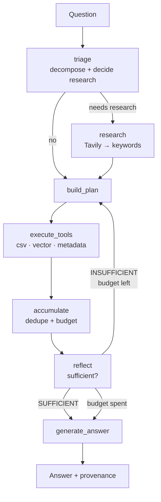

# Agentic RAG over Aircraft Maintenance Clusters

A planner-driven RAG system that answers questions about **230,573 aircraft maintenance work-order records**, organised into 51 issue *clusters* across 17 *parent groups*.

Instead of routing each question to a single retrieval method, a planner decomposes it into an evidence plan, runs several retrieval tools, accumulates evidence with provenance, and loops through a reflection judge until the evidence is sufficient.

**Everything runs locally.** The LLM is Ollama (`qwen3:8b`), embeddings are HuggingFace sentence-transformers, and the vector store is on-disk Chroma. No cloud LLM or embedding provider is involved. The only optional network call is Tavily research, which is strictly contained (see [Web research](#web-research-optional)).

---

## Quickstart

Requires Python 3.14 and [Ollama](https://ollama.com).

From a clean checkout:

```bash
# 1. Install dependencies
cd Maintenance-Knowledge-Base
python -m venv .gpt_rags
source .gpt_rags/bin/activate          # Windows: .gpt_rags\Scripts\activate
pip install -r requirements.txt

# 2. Get the local model
ollama pull qwen3:8b

# 3. Configure
cat > .env <<'EOF'
OLLAMA_MODEL=qwen3:8b
OLLAMA_BASE_URL=http://localhost:11434
EMBEDDING_MODEL=sentence-transformers/all-MiniLM-L6-v2
EOF
```

**4. Start Ollama in a second terminal** — it blocks, so it needs its own window:

```bash
ollama serve
```

Back in the first terminal:

```bash
# 5. Build the index (--reset deletes the old one first; Chroma appends)
python ingest.py --reset

# 6. Run it
python main.py
```

Then ask questions at the prompt; type `exit` or `quit` to stop.

```
Ask a question: How many records are in cluster c_22?

[plan] csv_lookup (c_22): What is the total number of records associated with cluster c_22?
[execute] csv_lookup returned 1 item(s)

--- Final Answer ---
The number of records in cluster c_22 is **1609**, as indicated by the evidence
from the file `data/final_joined_output.csv`.

--- Debug Info ---
Retrieval passes: 1
Evidence items: 1 via ['csv_lookup']
Sources: ['data/final_joined_output.csv']
Verdict: SUFFICIENT
```

**Already set up?** Every later session is just `ollama serve` in one terminal, and in another:

```bash
cd Maintenance-Knowledge-Base && source .gpt_rags/bin/activate
python main.py
```

You only need to re-run `python ingest.py --reset` if you change something in `data/` or the chunking settings.

**If something goes wrong:**

| Symptom | Fix |
|---|---|
| `could not connect to ollama server` | Start `ollama serve` in another terminal |
| `model "qwen3:8b" not found` | `ollama pull qwen3:8b` |
| `Cluster taxonomy not found` / `CSV knowledge base not found` | Run from the repo root — paths in `.env` are relative |
| Answers cite unrelated clusters | The index is stale or doubled: `python ingest.py --reset` |
| Startup pauses on `Loading model...` | Expected — the embedding model, a 46MB CSV and the ~5.6GB LLM load once, before the prompt |
| Answers feel slow | Lower `MAX_EVIDENCE_CHARS` and `OLLAMA_NUM_PREDICT` in `.env`; see [Configuration](#configuration) |

---

## How it works



### The three retrieval tools

| Tool | Backed by | Answers |
|---|---|---|
| `csv_lookup` | `final_joined_output.csv` | Counts, totals, raw records, work orders, registrations, ATA codes, schema |
| `vector_search` | Chroma + BM25 (hybrid), metadata-scoped | Cluster meaning, patterns, symptoms, corrective actions, comparisons |
| `metadata_search` | `cluster_taxonomy.csv` + Chroma | Which clusters belong to a group, group-level documents |

### Design decisions worth knowing

**The planner is a constrained selector, not a generator.** It picks a tool from a fixed enum and *names* entities. It can phrase a short sub-question, but it never controls the search scope. Every entity it names is validated against the taxonomy, so a hallucinated cluster ID is dropped before it can reach a tool. This is what makes an 8B model safe to plan with.

**A deterministic plan is always the floor.** Keyword and taxonomy matching produce a plan before the LLM is called. If the model errors or returns nothing valid, that plan runs instead — the system can never be worse than plain keyword routing.

**Metadata scoping prevents cluster substitution.** Each chunk is tagged with its `cluster`, `parent`, and `doc_type` at ingest, so a search scoped to `c_38` physically cannot return `c_37`'s document. Both the reflection and answer prompts also forbid substituting a similar cluster, and `reflect` enforces it deterministically before spending an LLM call.

**The loop is bounded.** Two replans (three passes) by default. On exhaustion the answer is generated in *partial* mode: answer what the evidence supports, then state plainly what is missing.

### Retrieval, evidence selection and chunking

**Hybrid search (BM25 + embeddings).** `vector_search` runs two retrievers over the same chunks with the same metadata scope: MiniLM embeddings for meaning, and BM25 (`bm25.py`, pure Python) for exact terms such as `mag drop`, `cht`, ATA codes and tail numbers, which a general-purpose embedding model handles poorly. The tokenizer keeps maintenance shorthand whole (`a/c`, `l/h`, `r&r`, `c_22`) and maps it to one canonical form (`mag` and `magneto` match). Each side returns `k x 3` candidates and the lists are fused with Reciprocal Rank Fusion (k=60), which only uses rank positions, so the two scores never need to be on the same scale. `RETRIEVAL_MODE=vector` restores the old behaviour.

**Evidence is ranked before the budget, not first-come.** `MAX_EVIDENCE_CHARS` (8000) used to be filled in arrival order, so one search could fill it and a replan's better evidence was dropped. Now (`evidence.py`) every retrieved item stays in `evidence_pool`, and every pass re-selects from the whole pool:

1. exact CSV facts are pinned first for count/record questions;
2. each cluster or group the question names gets its best item reserved, so every side of a comparison is present;
3. with two or more named entities, each gets an equal share of the budget first;
4. the rest of the budget goes to the most relevant remaining items.

Relevance is BM25 plus embedding cosine similarity, fused with RRF. Item embeddings are cached, so a replan only embeds new items. `EVIDENCE_SELECTION=arrival` restores the old behaviour.

**Chunking follows the documents' own structure.** The cluster documents are markdown (`## Common problem terms`, `### Example 3`), so `chunking.py` splits on those boundaries, packs whole units up to 600 characters, never splits an example record, and prefixes every chunk with `Cluster c_22: engine idle rpm issue | <section>` so each chunk says what it is about. Why 600 characters with 100 overlap:

- **MiniLM reads at most 256 tokens and silently drops the rest.** This text is dense (`- 7200.0: 288`, `N559ND: 27` is about 2.5 to 3 characters per token), so the old 1000-character chunks ran about 290 tokens at the median and roughly 75% of them lost their ending before being embedded. 600 is the largest size where no chunk goes over; 800 already puts about 11% over.
- **Smaller is not better.** 400 gives 1,200+ fragments, many too short to carry a pattern, and a search's top 8 then covers less of a cluster.
- **Overlap is only used where a cut happens.** Section and example boundaries are natural breaks, and overlapping them would only duplicate text, spend the evidence budget twice and make BM25 count the same terms twice. When a single section is longer than 600 characters, it is cut on line boundaries and the last ~100 characters of whole lines (about 15%) are carried over, so an entry that spans the cut is complete in at least one chunk.

These numbers are estimates from the data; `eval/measure_chunks.py` measures them in seconds with MiniLM's real tokenizer (add `--show-cut 2` to print the text that never gets embedded), and `eval/eval_chunking.py` also picks the best setting by retrieval quality. Files without `##` headers still use the recursive character splitter. `CHUNK_STRATEGY=recursive CHUNK_SIZE=1000 CHUNK_OVERLAP=200` restores the old chunking.

---

## Setup

The [Quickstart](#quickstart) above is the full install. A few details worth knowing when you deviate from it.

**Rebuilding the index.** `ingest.py` reads `data/`, splits it into about 730 chunks, tags each with its `cluster`/`parent`/`doc_type`/`section`, and writes to `chroma_db/`. It uses `Chroma.from_documents`, which **appends**, so always pass `--reset` (or delete `chroma_db/` first), or every document is indexed twice and answers start citing duplicates.

```bash
python ingest.py --reset
```

It accepts `--data-dir --db-dir --chunk-strategy --chunk-size --chunk-overlap --embedding-model --reset` if you need to build a variant index. Changing the embedding model requires a full rebuild — query-time and ingest-time embeddings must match or retrieval silently returns garbage.

**Enabling web research.** Add `TAVILY_API_KEY=...` to `.env`. Nothing else changes; see [Web research](#web-research-optional) for what it is and is not allowed to do.

---

## Usage

```bash
python main.py
```

Ask questions at the prompt; `exit` or `quit` to stop. Startup loads the embedding model, a 46MB CSV, and the ~5.6GB LLM — expect ~30s before the prompt appears, then **~15-25s** for a simple question and **~40s** for a multi-step one.

### Questions that work well

**Exact structured facts** — deterministic, no hallucination surface:
```
How many records are in cluster c_30?
How many clusters are there?
Show me records for cluster c_44
What is work order 1112782?
Show records for registration N556ND
Find records where the problem contains "mag drop"
```

**Cluster meaning:**
```
What is cluster c_30?
Explain cluster c_12
```

**Group-level synthesis** — fans out into several scoped searches:
```
What are common problem patterns across baffle clusters?
Summarize the ignition clusters
What corrective actions are common in the flight control group?
```

**Comparisons** — one retrieval per side, so neither crowds the other:
```
Compare c_30 and c_39
What is the difference between the cowling and baffle clusters?
```

The groups with the most material behind them are `inspection` (93k records), `flight_control` (15k across 5 clusters), `appearance_cleaning` (13k), `ignition` (9k), `landing_gear_tire` (8k), `cowling` (6k) and `pilot_reported` (6k). The `baffle` group has the richest *documents* — 10 clusters, 71 chunks — which makes it the best target for pattern questions.

### Reading the debug output

Every answer is followed by its plan and provenance:

| Line | Means |
|---|---|
| `Steps executed` | More than 1 means several tools genuinely contributed |
| `Evidence items: N via [...]` | Which tools produced the evidence |
| `Sources` | The real files behind the answer — if these look unrelated, distrust the answer |
| `Retrieval passes` | `1` is a clean hit; `2`–`3` means it replanned after judging the first attempt insufficient |
| `Verdict` / `Gaps` | `SUFFICIENT`, or what it could not find |

---

## Web research (optional)

Tavily can supply domain vocabulary to improve *planning*. It is deliberately boxed in:

- Runs only when triage requests it **and** `TAVILY_API_KEY` is set **and** `ENABLE_WEB_RESEARCH` is not false.
- The only thing that leaves `research.py` is a bounded list of short keywords — never prose, claims, or URLs.
- Those keywords reach the planner prompt and vector queries. **They can never reach the answer.** The guarantee is structural: `build_answer_prompt` and `build_reflection_prompt` accept only `(question, evidence)`, so there is no parameter through which research could arrive. Tests assert this.
- Every failure path is non-fatal — a missing key, missing package, or API error yields an empty list and the run continues locally.

To enable it, add `TAVILY_API_KEY=...` to `.env`. Nothing else changes — see `.env.example`.

Verified against live search: for *"What is a sniffler valve and which cluster covers it?"*, research produced 12 keywords, 7 of which appeared nowhere in the question or the retrieved evidence. None of those 7 reached the answer, which cited only local files. `test_workflow.py` runs this check whenever a key is present.

> `.env` is gitignored because it holds this key. If you fork or share the repo, distribute `.env.example` instead.

---

## Evaluation

The `eval/` folder measures the system instead of just checking that it runs. Run everything from the repo root after `python ingest.py --reset`.

```bash
python eval/check_gold.py       # validate the gold set against the data
python eval/eval_retrieval.py   # retrieval quality, no LLM needed (a few minutes)
python eval/measure_chunks.py   # token length of every chunk vs the model's limit (seconds)
python eval/eval_chunking.py    # chunk-size sweep with real token counts (~5-10 min)
python eval/eval_e2e.py         # full graph with Ollama (~20 min; --limit / --types for less)
```

**Gold set** (`eval/gold_questions.json`): 44 questions in 7 types, namely exact counts, single-cluster explanations, comparisons, group summaries, "which cluster covers X" lookups, clusters with no records (`c_38`, `c_50`), and nonexistent clusters. Expected counts come from `final_joined_output.csv`, and `check_gold.py` fails if they drift.

**`eval_retrieval.py`** runs every question through the deterministic plan, the tools, a simulated gap replan and the evidence selection, for every combination of `vector | bm25 | hybrid` and `arrival | ranked`. `vector+arrival` is the old system; `hybrid+ranked` is the new default.

| metric | meaning |
|---|---|
| coverage | share of the clusters/groups asked about that have real (non-definition) evidence |
| balanced | comparisons only: every side has real evidence |
| MRR | 1 / rank of the first item about exactly what was asked |
| scope precision | share of scoped items that belong to the asked cluster or its group |
| fact recall | share of expected numbers present in the evidence |

It also scores raw unscoped search (MRR@8, hit@3) on the lookup questions, which isolates vector vs BM25 vs hybrid.

**`eval_e2e.py`** checks the final answers: exact numbers, correct refusals, "no records" honesty, numbers or cluster IDs in the answer that are not in the evidence (the hallucination check), source citation, and latency p50/p95.

Results go to `eval/results/` as JSON and markdown (gitignored).

**What it found while building it.** The first run caught three real bugs, now fixed: group-scoped searches appended every member cluster's description to the query and drowned the user's words ("oil cooler problems" retrieved `c_34` oil leak instead of `c_32` oil cooler); "flight control" also matched the `pilot_reported` group through the word "flight"; and "Explain cluster c_50" produced no evidence at all because the keyword plan skipped the taxonomy definition. In a stress test with the old 1000-character chunks and a 4000-character budget, first-come selection left only 1 of 6 comparisons with evidence for both sides and covered 45% of lookups; ranked selection covered all of them. Those runs used a lexical stand-in for MiniLM in a sandbox, so rerun `eval_retrieval.py` for numbers on the real model.

## Testing

```bash
python test_retrieval.py     # 26 offline checks: BM25, fusion, chunking, evidence selection
python test_workflow.py      # 33 checks: 23 offline, 4 live, 6 web research
python test_csv_lookup.py    # CSV layer smoke check
```

All are plain print/assert scripts, not pytest, and nothing runs them automatically.

`test_workflow.py` degrades gracefully: the 23 offline checks need nothing, the 4 live checks skip without Ollama, and the 6 web-research checks skip without `TAVILY_API_KEY`. `test_retrieval.py` needs only pandas.

Covered: taxonomy and plan validation, hallucinated-entity rejection, the deterministic planner across all five question shapes, research containment (both structurally and end-to-end against live search results), four end-to-end questions, BM25 and rank fusion, chunk limits and boundaries, and evidence selection (late relevant evidence kept, fair comparison budget, pinned CSV facts).

Not yet covered: the LLM replan loop itself (every live test hits SUFFICIENT on the first pass), `ingest.metadata_for()`, and `retriever.build_filter()`.

---

## Project layout

```
main.py          CLI loop and debug output
graph.py         LangGraph topology
nodes.py         Thin nodes + prompt builders
graph_state.py   State contract (EvidenceItem, PlanStep)
planner.py       Schemas, triage, plan building, validation
research.py      Tavily contract (self-contained)
tools.py         The three retrieval tool dispatchers
taxonomy.py      Single source of truth for clusters and groups
csv_lookup.py    Structured record queries
retriever.py     Hybrid search: Chroma + BM25, metadata-scoped, RRF fusion
bm25.py          BM25, maintenance tokenizer, reciprocal rank fusion
evidence.py      Evidence pool, relevance ranking, budgeted selection
chunking.py      Structure-aware markdown chunking
ingest.py        Loading, chunking, metadata enrichment, indexing
llm.py           Local model factory
eval/            Gold set and evaluation scripts
```

`data/` holds one document per cluster (`cluster_c_<n>.txt`), whole-group documents (`cluster_<group>_unspecified.txt`), the record-level `final_joined_output.csv`, and `cluster_taxonomy.csv`. `chroma_db/` is generated and fully rebuildable from `data/`.

### Configuration

All settings in `config.py` are environment-overridable. The ones you're most likely to touch:

| Variable | Default | Purpose |
|---|---|---|
| `OLLAMA_MODEL` | `qwen3:8b` | Local chat model |
| `OLLAMA_NUM_CTX` | `8192` | Context window — must exceed a full evidence prompt |
| `OLLAMA_NUM_PREDICT` | `700` | Answer length cap — uncapped, the model writes 4000-token essays |
| `RETRIEVAL_K` | `8` | Documents per vector search, multiplied across plan steps |
| `RETRIEVAL_MODE` | `hybrid` | `hybrid`, `vector` or `bm25` |
| `BM25_WEIGHT` | `1.0` | BM25's weight against vector search in fusion |
| `EVIDENCE_SELECTION` | `ranked` | `ranked` (relevance first) or `arrival` (old first-come) |
| `CHUNK_STRATEGY` | `markdown` | `markdown` (section-aware) or `recursive` (fixed windows) |
| `CHUNK_SIZE` / `CHUNK_OVERLAP` | `600` / `100` | Characters, not words; re-ingest after changing |
| `MAX_ITERATIONS` | `2` | Replans allowed after the first pass |
| `MAX_PLAN_STEPS` | `4` | Tool calls per plan |
| `MAX_EVIDENCE_CHARS` | `8000` | Evidence budget — bounds both context use and latency |
| `TAVILY_API_KEY` | *(unset)* | Enables web research when present |

> Ollama defaults `num_ctx` to 4096, which is smaller than a full evidence prompt. Left at the default, prompts are silently truncated and the judge grades evidence it never saw. If you raise `MAX_EVIDENCE_CHARS`, raise `OLLAMA_NUM_CTX` with it.

> The embedding model at query time **must** match the one used at ingest, or retrieval silently returns garbage. Change `EMBEDDING_MODEL` only alongside a full re-ingest.

---

## Known limitations

- **`c_38` (sniffler valve) and `c_50` (spoiler)** exist in the taxonomy but have zero documents and zero records. Questions about them return the definition and state that no records exist — a data gap, not a bug.
- **ATA codes only match 4 digits.** `ATA 3240` works; `ATA 520` does not — the extractor regex is `\d{4}`.
- **~15-40s per question** on an M4 — four sequential local LLM calls (triage, plan, reflect, answer). Two settings dominate: `OLLAMA_NUM_PREDICT` caps generation (~26 tok/s), and prompt processing costs roughly 1.7s per 1000 characters, which `MAX_EVIDENCE_CHARS` bounds. Raising either trades latency for depth.
- **The BM25 index is built from Chroma at the first search**, so it always matches the vector index, but a re-ingest needs an app restart to be seen.
- Roughly 48k records carry an `UNKNOWN` cluster label and are not reachable through cluster-scoped questions.
